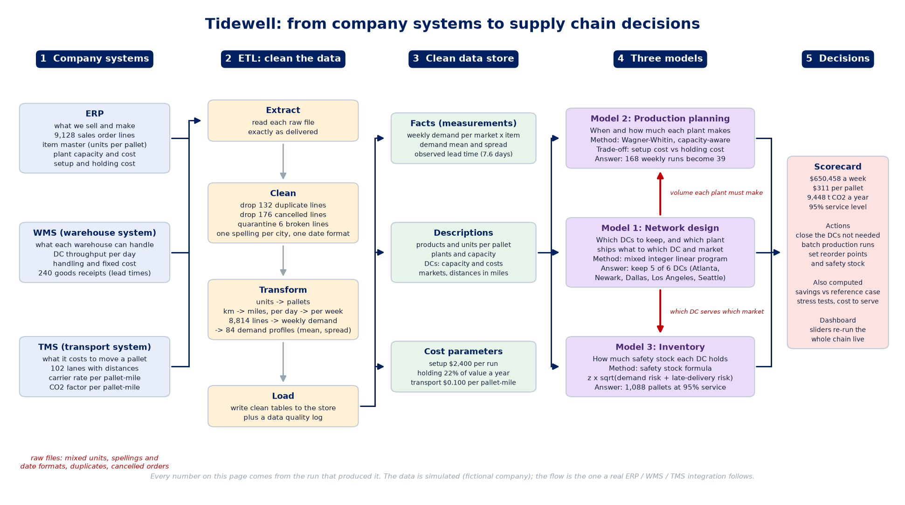
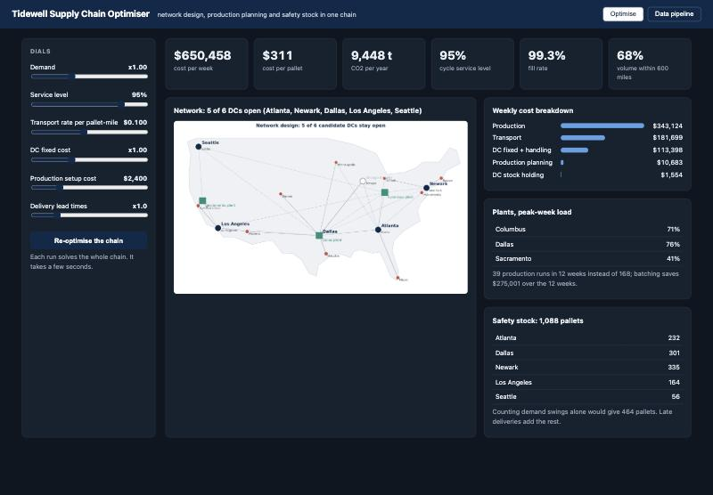
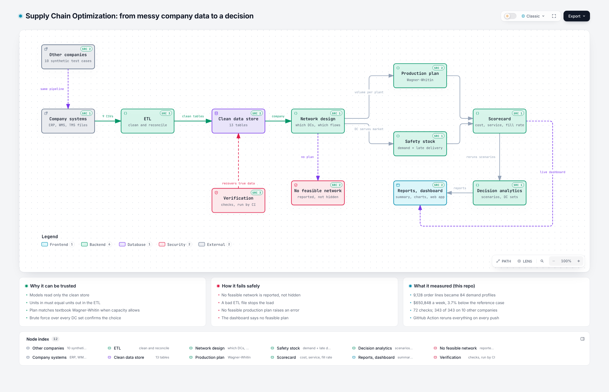

# Supply Chain Optimization

*Tidewell Beverages, a fictional US drinks company: from messy ERP, WMS and TMS data to a network, production and inventory decision.*

An end-to-end supply chain project for a fictional American drinks company (plants in Columbus, Dallas and Sacramento; DCs from Atlanta to Seattle; dollars and road miles): messy ERP, WMS and TMS extracts are cleaned by an ETL,
loaded into a clean data store, and fed to three optimisation models (network design, production planning, safety stock). On top of the
models sits a decision layer: savings against a reference case, a whole-chain comparison of every DC set, stress tests, input sensitivity and cost
to serve. A dashboard re-runs the whole chain live.



The dashboard re-runs the whole chain when you move a dial:



## Architecture

<picture>
  <source media="(prefers-color-scheme: dark)" srcset="docs/architecture/supply-chain-optimization-architecture-dark.png">
  
</picture>

Every box is traced to the code. The [interactive version](https://akashhalgekar.github.io/supply-chain-architecture.html) has a link from each box to the exact lines of code. Built with [Archify](https://github.com/tt-a1i/archify); the diagram's source is `docs/architecture/architecture.spec.json`.

## From data to decision

1. **Data in.** 9,128 raw ERP order lines, 240 WMS goods receipts and 102 TMS lanes (simulated, deliberately messy).
2. **Cleaned.** The ETL removes 132 duplicate, 176 cancelled and 6 broken lines, converts units and kilometres, and reconciles every unit: 8,814 clean lines become 84 weekly demand profiles (mean and spread per market and item).
3. **Inputs checked.** Freight rate, holding rate, trailer size and road distances benchmarked against 2026 sources ([docs/DATA_AND_ASSUMPTIONS.md](docs/DATA_AND_ASSUMPTIONS.md)).
4. **Modelled.** Network design picks DCs and flows, Wagner-Whitin plans production, and safety stock covers demand swings and late deliveries.
5. **Tested.** Every DC combination costed on the whole chain, nine stress tests, sensitivity on every input and assumption, and the same checks on ten other synthetic companies.
6. **Conclusion.** The cheapest network closes Chicago ($650,848 a week, 3.7% below the reference case). Keeping all six DCs costs only 0.4% more and lifts next-day coverage from 68% to 80%, so the recommendation is to keep all six. 57% of safety stock exists because deliveries arrive late, and production runs fall from 168 to 43.

**Start with [docs/ONE_PAGE_SUMMARY.md](docs/ONE_PAGE_SUMMARY.md) (one page), then [docs/PROJECT_STORY.md](docs/PROJECT_STORY.md) (the story and how AI was used).**

| For | Read |
| --- | --- |
| What data it uses and how much each input matters | [docs/DATA_AND_ASSUMPTIONS.md](docs/DATA_AND_ASSUMPTIONS.md) |
| Whether it holds up on other data | [docs/ROBUSTNESS.md](docs/ROBUSTNESS.md) |
| The decision a manager would take | [docs/EXECUTIVE_SUMMARY.md](docs/EXECUTIVE_SUMMARY.md) |
| How it works, in plain words | [docs/HOW_IT_WORKS.md](docs/HOW_IT_WORKS.md) |
| Mistakes found and fixed | [docs/AUDIT.md](docs/AUDIT.md) |
| Interview questions with answers | [docs/INTERVIEW_QA.md](docs/INTERVIEW_QA.md) |

The case structure was inspired by a Supply Science video; see [docs/ATTRIBUTION.md](docs/ATTRIBUTION.md).

## What it finds (in the simulated company)

- The lowest-cost network closes Chicago: **$650,848 a week, 3.7% below a reference case** of all six DCs open. Keeping all six costs only 0.4% more and raises next-day coverage from 68% to 80%, so the recommendation is to keep all six: the real decision is service, not cost.
- Production runs fall from 168 to 43 over 12 weeks, inside the 90% plant planning limit and shelf-life limits.
- 57% of safety stock exists because deliveries arrive late, not because demand swings. That share depends on the delivery-time spread assumed for the simulated DCs: 32% at half that spread, 77% at double. It shows the method, not a discovery about real companies.
- Demand can grow about 40% before the network cannot serve it. Losing Columbus or Dallas leaves demand unmet, and a next-day (600 mile) promise cannot be met from these sites.

[docs/AUDIT.md](docs/AUDIT.md) lists the mistakes a supply chain manager would spot in a project like this and how each was fixed.

## Ask the analyst: your own supply chain, not just Tidewell

The dashboard has an AI analyst (Claude) that works on **the visitor's own problem**. Describe your situation in plain
words ("I sell about 400 units a week, give or take 120, and my supplier is often late") and Claude turns it into the
right calculation, runs it, and ends with **What to do next**: two or three concrete actions tied to the numbers.

| Tool | What it answers | Method (same as in Tidewell) |
| --- | --- | --- |
| `safety_stock` | How much buffer, the reorder point, how much of it late deliveries cause, what 99% service costs | z x sqrt(LT x sd_D^2 + D^2 x sd_LT^2), fill rate from the loss function |
| `lot_sizing` | How often to run or order, against lot-for-lot and EOQ | Wagner-Whitin dynamic programme |
| `network_design` | Which warehouses to run and who serves whom, and what each open/close decision is worth | facility location MIP (PuLP/CBC) |
| `tidewell_scenario` | What-ifs on the worked example | the full Tidewell chain |

Every number comes from code, never from the model's memory. Each calculation is shown under the answer.

**Nobody pays for anyone else's tokens.** The visitor brings their own Anthropic API key. The page calls Claude straight
from their browser, and the key is held in that tab only. When Claude asks for a calculation, only that tool call
comes to this server (`POST /api/advisor/tool`), which is pure computation. The server holds no key and never imports the
Anthropic SDK; a check fails the build if that ever changes. A per-visitor and site-wide hourly cap guards the server's
CPU (`TIDEWELL_TOOL_PER_HOUR`, `TIDEWELL_TOOL_SITE_HOUR`).

### Use it in Claude Desktop (MCP)

The same four tools also run as an MCP server, the way Samir Saci connects his network optimiser to Claude. Nothing to
pay beyond your own Claude plan, and no key to paste:

```bash
pip install -r requirements.txt
python -m tidewell.mcp_server        # MCP over stdio
```

```json
{"mcpServers": {"tidewell": {"command": "python", "args": ["-m", "tidewell.mcp_server"],
                             "cwd": "/path/to/supply-chain-optimization"}}}
```

Add that to Claude Desktop's config (Settings, Developer, Edit config) and restart it. The server also offers a
`supply_chain_analyst` prompt with the same instructions the website uses.

How the pieces fit: `tidewell/calculators.py` (the three calculators), `tidewell/assistant.py` (system prompt, tool
definitions, one `Toolbox` that runs them), `tidewell/api.py` (website endpoints), `tidewell/mcp_server.py` (MCP), and
`python -m tidewell.assistant_check` (74 checks, no key needed: calculators against hand formulas and brute force,
the Tidewell tool against direct runs, the endpoints, and the MCP server).

## Run it

```bash
python3 -m venv .venv && .venv/bin/pip install -r requirements.txt
.venv/bin/python -m tidewell.run                 # data, ETL, models, analytics; writes output/, charts/, docs/EXECUTIVE_SUMMARY.md (about 2 minutes)
.venv/bin/python verify.py                       # checks on Tidewell, its inputs and the documents (about 3 minutes)
.venv/bin/python -m tidewell.robustness          # the same checks on 10 other synthetic companies (about 3 minutes)
.venv/bin/uvicorn tidewell.api:app --port 8000   # dashboard at http://localhost:8000
```

The live version is a Docker image (`Dockerfile`) deployed to Hugging Face Spaces by `.github/workflows/deploy-space.yml`
whenever `main` changes, using one repository secret, `HF_TOKEN`. No Anthropic key is deployed.

## Layout

| Path | What it holds |
| --- | --- |
| `tidewell/company.py` | the fictional company and the dials the models read |
| `tidewell/sources.py` | plays the ERP, WMS and TMS: writes messy raw extracts |
| `tidewell/etl.py`, `store.py` | extract, clean, transform, load; then build the company from clean tables |
| `tidewell/network.py` | mixed integer program: which DCs, which flows |
| `tidewell/lotsizing.py` | Wagner-Whitin and the capacity-aware production plan |
| `tidewell/safetystock.py` | safety stock, reorder points, fill rate |
| `tidewell/chain.py` | the three models in sequence, with the scorecard |
| `tidewell/analytics.py` | savings, DC set comparison, stress tests, sensitivity, cost to serve |
| `tidewell/api.py`, `web/` | API and dashboard |
| `tidewell/calculators.py`, `assistant.py`, `mcp_server.py`, `assistant_check.py` | the AI analyst: calculators for a visitor's own data, tool definitions, the MCP server, and their checks |
| `tidewell/checks.py`, `verify.py` | checks that hold for any company, plus Tidewell-only checks on inputs and documents |
| `tidewell/synthetic.py`, `robustness.py` | generator of other synthetic companies and the robustness test |
| `data/raw`, `data/warehouse` | messy extracts and clean tables |
| `output/`, `charts/` | result tables (CSV) and charts (PNG) |

Everything is simulated and deterministic.
